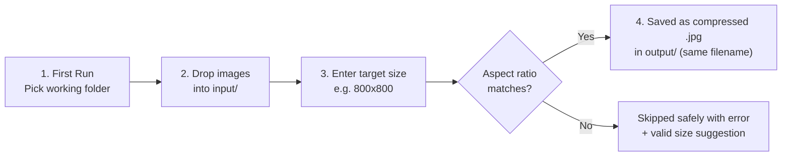

# Image Compress Automation

[](https://nodejs.org/)
[](LICENSE)

**Zero-Photoshop bulk image resizer & JPG compressor for small businesses.**  
Turn **40+ MB** of heavy PNG product images into **~2 MB** of fast-loading, web-ready JPGs in **under 10 seconds**—on Windows, macOS, or Linux.

---

## Why This Exists

Small e-commerce stores (Shopify, WooCommerce, Etsy) often receive high-resolution PNG files straight from designers without having Photoshop installed. Uploading 2 MB+ PNGs slows down product pages and hurts SEO, while editing dozens of files one-by-one in browser tools takes forever.

With **Image Compress Automation**:
- ✅ **Works on any computer or drive** — asks you on first run where you want your `input` and `output` folders (Windows `C:\`/`D:\`/`F:\`, macOS, or Linux).
- ✅ **Fast bulk conversion** — converts entire batches of `.png`, `.jpg`, `.jpeg`, and `.webp` files in seconds using [`sharp`](https://sharp.pixelplumbing.com/).
- ✅ **Keeps your exact filenames** — `Heart Blue.png` becomes `Heart Blue.jpg`.
- ✅ **Protects image proportions** — strictly verifies aspect ratios (EXIF-aware) and refuses to silently crop or stretch mismatched images.
- ✅ **Clean backgrounds for transparent PNGs** — automatically flattens transparency onto white (`#ffffff`, customizable via `--bg`) instead of turning black.
- ✅ **AI Assistant ready** — includes [`AGENTS.md`](AGENTS.md) and [`skills/image-compress-automation/SKILL.md`](skills/image-compress-automation/SKILL.md) so AI coding tools follow the exact same safe workflow.

---

## How the Process Works



---

## Quick Start (4 Simple Steps)

> Need a super detailed beginner guide (with Node.js install steps)? Read the full walkthrough in **[`docs/PROCESS.md`](docs/PROCESS.md)**.

### 1. Install Node.js (one-time)
Download and install **Node.js 20 LTS or newer** from [nodejs.org](https://nodejs.org/).

### 2. Download or Clone This Repository
```bash
git clone https://github.com/alirazawebservice-rgb/image-compress-automation.git
cd image-compress-automation
```
*(Or click **Code → Download ZIP** on GitHub, unzip it, and open Terminal / PowerShell inside that folder.)*

### 3. Install Dependencies (one-time)
```bash
npm install
```

### 4. Run It!
```bash
npm start
```

**On your very first run**, it asks where you want to store your images:
```text
👋 First-time folder setup (you can change this anytime with --setup or --dir)
📁 Enter working folder for "input" & "output" [Press Enter for "..."]: D:\Store Images
💾 Saved working folder: D:\Store Images
```

It automatically creates:
- `D:\Store Images\input\` ← **drop your raw PNG/JPG/WEBP images here**
- `D:\Store Images\output\` ← **pick up your compressed JPGs here**

Run `npm start` again once your images are inside `input/`, enter your target size (e.g. `800x800`), and watch it shrink the batch in seconds:

```text
📐 Found 24 image(s). Enter target size (e.g. 800x800, 1200x628) [Enter for 800x800]: 800x800

  ✅ Boat Navy.png  →  Boat Navy.jpg
     📐 1600x1600  →  800x800
     📦 1966.1 KB  →  68.2 KB  (97% smaller)
...
════════════════════════════════════════
✅ 24 converted   ⚠️  0 skipped   ❌ 0 failed
💾 Total space saved: 41.96 MB
📁 Output saved to: D:\Store Images\output
```

---

## Aspect Ratio Safety (No Accidental Cropping)

If you drop a **1:2 banner** (`500x1000`) into `input/` and ask for **800×800** (`1:1`), the tool **will not distort or crop it**. Instead, it protects your image and tells you what size matches its natural ratio:

```text
  ❌ ERROR (SKIPPED): tall-banner.png
     Source ratio: 1:2 (500x1000)
     Target ratio: 1:1
     Cannot distort 1:2 → 1:1.
     💡 Tip: Try 800x1600 or 400x800 to keep the original ratio.
```

*(A tiny 1% rounding tolerance is allowed so standard sizes like `1920x1080` → `1000x563` work smoothly.)*

---

## Command-Line Options

You can pass flags directly with `node bin/cli.js` (or `node convert.js` for backwards compatibility, or `npm start -- <flags>`):

| Option | Alias | Default | Description |
|---|---|---|---|
| `--size <WxH>` | `-s` | Prompt / `800x800` | Target pixel dimensions (e.g. `800x800`, `1200x628`, `1080*1080`) |
| `--dir <path>` | `-d` | Saved config / cwd | Working folder containing `input/` and `output/` |
| `--input <path>` | `-i` | `<dir>/input` | Custom input folder path |
| `--output <path>` | `-o` | `<dir>/output` | Custom output folder path |
| `--quality <1-100>` | `-q` | `85` | JPEG compression quality (`mozjpeg`) |
| `--bg <hex>` | — | `#ffffff` | Background fill color for transparent PNGs |
| `--setup` | — | `false` | Re-prompt and save a new default working folder |
| `--reset` | — | `false` | Clear saved working folder config (`.imagerc.json`) |
| `--strict` | — | `false` | Exit with code `1` if any image is skipped or fails |
| `--yes` | `-y` | `false` | Skip interactive prompts and use defaults |
| `--help` | `-h` | — | Show help message |
| `--version` | `-v` | — | Show version number |

### Common Examples

```bash
# Interactive setup & prompts
npm start

# Change your saved working folder anytime
npm run setup

# Process a specific folder directly without prompts
node bin/cli.js --dir "~/Desktop/my-products" --size 800x800

# Custom input/output folders with 90% quality and light-gray background for PNGs
node bin/cli.js --input ./raw --output ./ready --size 1200x1200 --quality 90 --bg "#f5f5f5"
```

---

## Using With an AI Coding Assistant

If you open this repository inside **Antigravity**, **Claude Code**, **Cursor**, or **Codex**, the assistant automatically reads [`AGENTS.md`](AGENTS.md) and [`skills/image-compress-automation/SKILL.md`](skills/image-compress-automation/SKILL.md).

Just tell your AI assistant:
- *"Help me set up my image folder and compress my PNGs"*
- *"Resize the images in my `input` folder to `800x800`"*

The assistant will ask for your folder (if not set), ask for your target dimensions, run the CLI safely, and report the exact MB saved.

---

## Project Structure

```text
image-compress-automation/
├── bin/cli.js                           # Main CLI entry point
├── convert.js                           # Backwards-compatible CLI wrapper
├── src/
│   ├── config.js                        # Cross-platform path & .imagerc.json management
│   ├── parser.js                        # Argument, dimension, and hex color parsing
│   ├── processor.js                     # Sharp batch conversion, transparency flatten, collision checks
│   ├── prompt.js                        # Interactive folder & size prompts
│   └── ratio.js                         # EXIF-aware aspect ratio validation & suggestions
├── skills/image-compress-automation/
│   └── SKILL.md                         # Tested cross-agent AI skill
├── AGENTS.md                            # AI assistant repository instructions
├── docs/
│   ├── PROCESS.md                       # Beginner step-by-step user guide
│   └── ci.example.yml                   # Cross-OS GitHub Actions CI template
├── test/                                # Automated unit & integration tests (node --test)
└── LICENSE                              # MIT License
```

---

## Running Tests & Privacy Guarantee

Run the automated test suite (`node --test`):

```bash
npm test
```

Your personal product photos inside `input/`, compressed results in `output/`, and local folder setting in `.imagerc.json` are all excluded by [`.gitignore`](.gitignore) so private business assets are never accidentally pushed to Git.

---

## Further Reading

- **[Step-by-Step User Process Guide](docs/PROCESS.md)** — Beginner-friendly setup for Windows, macOS, and Linux
- **[Contributing Guide](CONTRIBUTING.md)** — How to run tests and submit pull requests
- **[Changelog](CHANGELOG.md)** — Release history
- **[MIT License](LICENSE)** — Free for personal and commercial small-business use
